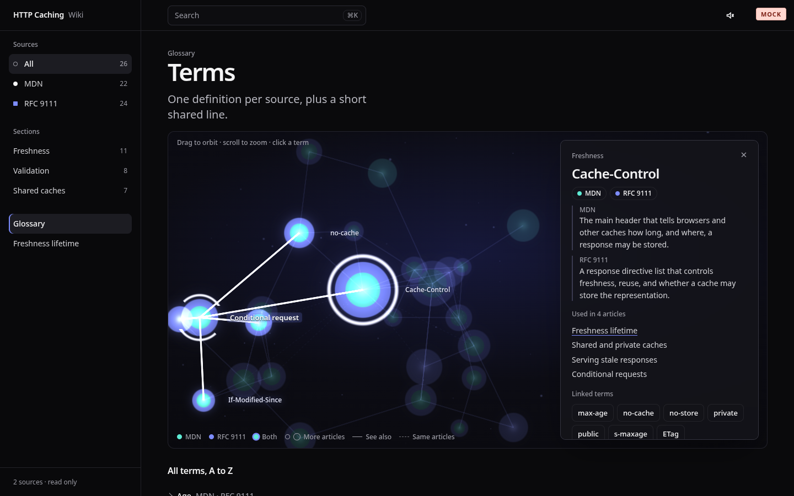

# wiki-this

An agent skill that builds one merged, local wiki from the folders, repos or projects you name.
Articles, guides and a glossary land as ordinary HTML on your machine. A normal run sends
nothing anywhere.

The only network step is optional: step 2b may look up **public concept names only**
(for example "idempotence") on Wikipedia and Grokipedia, to catch missing or conflicting
definitions. Source text, file paths and private names are never sent. You can skip that
step offline.

A five-step lesson preview can be written next to an article. Full courses are not live.
Each lesson ends with a link to join a waitlist. The lesson file itself collects nothing.

## What you get

Each run builds a local wiki plus a 3D glossary of its terms.


Sample wiki built from public HTTP caching docs.



Preview of the next look. Sample wiki built from public HTTP caching docs.

[Watch the 13s demo](docs/images/dark.webm)

## Install

The folder you copy must be named `wiki-this` and must contain `SKILL.md`. Then ask the agent to `/wiki-this` on a source you can read.

One-line install, user-wide, for Claude Code, Cursor, Codex and OpenClaw:

```sh
npx skills add sunnypatneedi/wiki-this --skill wiki-this -g -a claude-code -a cursor -a codex -a openclaw -y
```

That writes the skill to `~/.agents/skills/wiki-this/`. Cursor and Codex load that folder. The same command also adds:

- Claude Code: a symlink at `~/.claude/skills/wiki-this/`
- OpenClaw: a symlink at `~/.openclaw/skills/wiki-this/`

Or copy the folder by hand:

| Agent | User folder | Project folder |
| --- | --- | --- |
| Claude Code | `~/.claude/skills/wiki-this/` | `.claude/skills/wiki-this/` |
| Cursor | `~/.cursor/skills/wiki-this/` or `~/.agents/skills/wiki-this/` | `.cursor/skills/wiki-this/` or `.agents/skills/wiki-this/` |
| Codex | `~/.agents/skills/wiki-this/` | `.agents/skills/wiki-this/` |
| OpenClaw | `~/.openclaw/skills/wiki-this/` or `~/.agents/skills/wiki-this/` | workspace `skills/wiki-this/` or `.agents/skills/wiki-this/` |

Tested Nov 2026: Claude Code, Codex and OpenClaw load it. Cursor uses the same folder format.

Codex still loads the older user path `~/.codex/skills/wiki-this/`. Prefer `~/.agents/skills/` for new installs.

OpenClaw also has its own installer:

```sh
openclaw skills install git:sunnypatneedi/wiki-this
```

Add `--global` to install into `~/.openclaw/skills/` for every local agent.

This repo is a standalone skill folder, not a Claude Code plugin or a Cursor marketplace plugin, so `/plugin install` does not apply yet.

Smoke test, from this folder:

```sh
sh scripts/build-sample.sh /tmp/sample-wiki
```

Open `/tmp/sample-wiki/examples/article.html`.

## Example output

`examples/http-caching-lesson.html` is a five-step lesson on HTTP caching, written from
public docs (MDN and RFC 9111). The footer reads "Want a full course on this? Join the list".
The link opens the waitlist at `https://sunnypatneedi.com/prompts#wiki-this`. The lesson file itself
sends nothing.

## Privacy

- Wikis are built locally. Nothing is uploaded unless you later ask to publish.
- The optional cross-check sends public concept names only, over GET, with no keys.
- Generated lesson files send nothing and collect nothing.
- The waitlist, when it exists, stores an email and that the signup came from wiki-this.
  It is a page you open in the browser, not something the HTML file posts on its own.

## License

MIT. Copyright (c) 2026 Sunny Patneedi.
