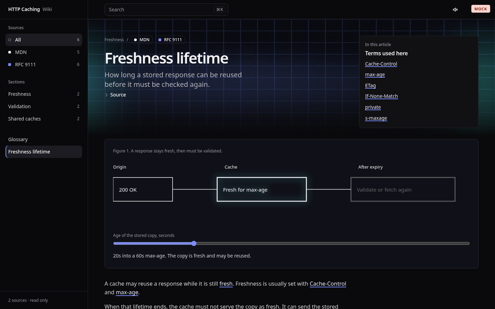
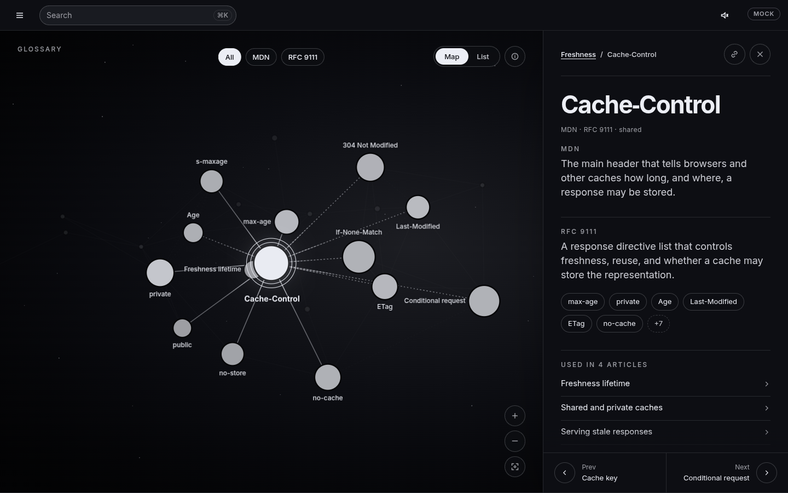
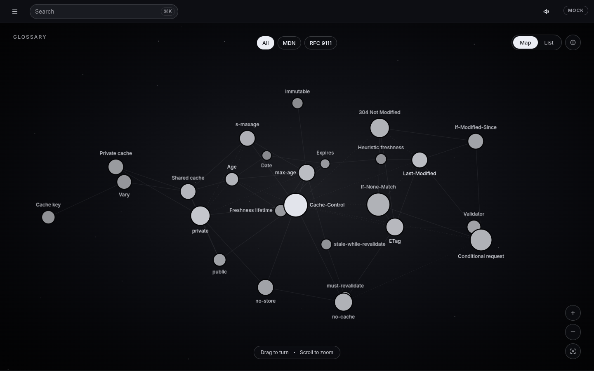
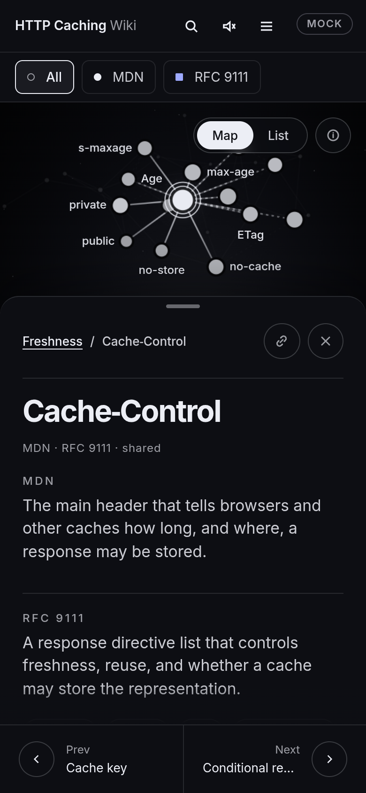

# wiki-this

An agent skill that builds one merged, local wiki from the folders, repos or projects you name.
Articles, guides and a glossary land as ordinary HTML on your machine. A normal run sends
nothing anywhere.

The only network step is optional: step 2b may look up **public concept names only**
(for example "idempotence") on Wikipedia and Grokipedia, to catch missing or conflicting
definitions. Source text, file paths and private names are never sent. You can skip that
step offline.

A local lesson can be written next to an article. The HTTP caching example now runs a
portable lesson session: a short starting question, authored examples and hints, and
practice with feedback. It works from `file://` without a model or server. A plain
five-step reading version remains available. Full courses are not live.

## What you get

Each run builds a local wiki plus a 3D glossary map of its terms (with an A to Z list underneath).



Sample wiki built from public HTTP caching docs.







Sample wiki built from public HTTP caching docs.

[Watch the 13s demo](docs/images/dark.webm)

## Install

The folder you copy must be named `wiki-this` and must contain `SKILL.md`. Then ask the agent to `/wiki-this` on a source you can read.

One-line install, user-wide, for Claude Code, Cursor, Codex and OpenClaw:

```sh
npx skills add sunnypatneedi/wiki-this --skill wiki-this -g -a claude-code -a cursor -a codex -a openclaw -y
```

That writes the skill to `~/.agents/skills/wiki-this/`. Cursor and Codex load that folder. The same command also adds:

- Claude Code: a symlink at `~/.claude/skills/wiki-this/`
- OpenClaw: a symlink at `~/.openclaw/skills/wiki-this/`

Or copy the folder by hand:

| Agent | User folder | Project folder |
| --- | --- | --- |
| Claude Code | `~/.claude/skills/wiki-this/` | `.claude/skills/wiki-this/` |
| Cursor | `~/.cursor/skills/wiki-this/` or `~/.agents/skills/wiki-this/` | `.cursor/skills/wiki-this/` or `.agents/skills/wiki-this/` |
| Codex | `~/.agents/skills/wiki-this/` | `.agents/skills/wiki-this/` |
| OpenClaw | `~/.openclaw/skills/wiki-this/` or `~/.agents/skills/wiki-this/` | workspace `skills/wiki-this/` or `.agents/skills/wiki-this/` |

Tested Nov 2026: Claude Code, Codex and OpenClaw load it. Cursor uses the same folder format.

Codex still loads the older user path `~/.codex/skills/wiki-this/`. Prefer `~/.agents/skills/` for new installs.

OpenClaw also has its own installer:

```sh
openclaw skills install git:sunnypatneedi/wiki-this
```

Add `--global` to install into `~/.openclaw/skills/` for every local agent.

This repo is a standalone skill folder, not a Claude Code plugin or a Cursor marketplace plugin, so `/plugin install` does not apply yet.

Smoke test, from this folder:

```sh
sh scripts/build-sample.sh /tmp/sample-wiki
```

Open `/tmp/sample-wiki/examples/article.html`.

## Example output

`examples/http-caching-lesson.html` is a local HTTP caching lesson drawn from MDN and
RFC 9111. Open `examples/article.html`, choose a source filter if wanted, and follow
**Open the lesson**. The ordinary link also works without the player.

The player starts with an unknown competency level. It checks authored multiple-choice
tasks, records hints and other support, and reports local practice evidence. Correct
answers do not become a verified mastery claim. The source filter narrows eligible tasks;
if the pack cannot support a selection, the player says so.

The footer reads "Want a full course on this? Join the list". Its link opens the waitlist
at `https://sunnypatneedi.com/prompts?src=wiki-this#wiki-this` only when chosen.

## Portable lesson integration

The sample separates three small pieces:

| Piece | Location | Responsibility |
| --- | --- | --- |
| Learning pack | `references/sample/learning-pack.js` | Generated, content-only tasks and source provenance. No learner profile. |
| Shared runtime | `assets/learning/learner-runtime.js` | The bundled LearnerContextKit session facade, with its origin recorded in `PIN.md`. |
| Wiki adapter | `assets/learning/wiki-adapter.js` and `lesson.css` | Host source scope, safe text rendering, controls and local checkpoint files. |

The canonical `references/sample/learning-pack.json` fixture generates `learning-pack.js`;
the build checks that the two agree. The script form lets the same sample open directly from disk without fetching
JSON or requiring JavaScript modules. Do not hand-edit the generated runtime or data.

The host calls `LearnerLesson.createLessonSession({ pack, entryId, sourceIds })` and
renders the views returned by `next()`, `answer()` and `help()`. The same headless
contract supports another app or a skill host. The wiki does not implement a second
assessment or scheduling engine. This first version supports text and single-choice
practice; it does not generate a course, connect a model, or refresh web sources.

### Headless skill or app host

The vendored `scripts/lesson-cli.mjs` runs the same runtime through one JSON request on
stdin and one response on stdout. From this repository folder, start the sample with:

```sh
node --input-type=module -e '
import fs from "node:fs";
const pack = JSON.parse(fs.readFileSync("references/sample/learning-pack.json", "utf8"));
console.log(JSON.stringify({operation: "start", pack, entryId: "freshness-lifetime"}));
' | node scripts/lesson-cli.mjs
```

The response contains `view`, `progress` and `checkpoint`. The **host must store the
checkpoint** and send it with the same pack on later calls. Use `resume` to reopen the
saved screen, `answer` or `help` for an actual learner action, and `next` to advance from
feedback. `progress` reads progress without presenting another activity. The CLI is
stateless, takes no command-line arguments, makes no network calls and does not save
progress files itself. Invalid input emits a JSON error on stderr and exits nonzero.

See [the headless protocol and agent instructions](references/learning.md#headless-host-protocol)
for complete request shapes, retry behavior and checkpoint handling. This is a local
integration entry point; it does not install or register a skill in an agent product.

### Keeping progress

Progress stays in memory for the current tab. Closing or refreshing the page loses it
unless the learner chooses **Save or resume → Export progress**. Import validates the
pack, entry, source scope and recorded actions before replacing the current session.
It can resume a compatible checkpoint from another host of the same runtime.

Checkpoint files contain local answers and assistance history. Keep them private; never
include them in a published wiki or learning pack. They are editable and untrusted, and
restored observations remain provisional. This does not depend on browser storage or
promise automatic persistence across `file://` pages.

### Source dates and fallback

The player shows recorded source check dates. An offline snapshot does not claim to be
current today. Links open only when the reader chooses them; no background refresh runs.
If scripts are unavailable, the five-step reading version remains usable. It includes
both listed sources and clearly distinguishes itself from filtered interactive practice.

## Connected demonstration

The optional served demo connects the same presenter to LearnerEngine using **synthetic
learner context**. It does not connect your personal learning history. Start it locally:

```sh
node scripts/serve-connected-learning.mjs
```

Open `http://127.0.0.1:4179/examples/http-caching-connected.html`, choose **Unknown**,
**Guided** or **Check**, then choose **Connect demo**. No session or source request starts
just by loading the page. The host selects an authored starting activity from the chosen
synthetic history and can check its approved public MDN and RFC sources. The source
panel distinguishes successful checks, failures, old snapshots and dated update signals;
a byte change does not establish that a lesson needs new instruction.

The ordinary `http-caching-lesson.html` remains local and works directly from disk.
The connected example refuses connected operation under `file://` and offers an ordinary
link to that offline lesson. It never silently switches or uploads a local checkpoint.

The demo keeps sessions in **server process memory**. It issues an ephemeral token after
the deliberate profile selection and holds it only in the page's memory. Keep the tab
open to reconnect; closing it loses the in-memory credential, and stopping the server
loses demo sessions. There is no account sync, deployed identity service or remote
checkpoint import/export.

For deterministic source fixtures or an explicit offline-source demonstration:

```sh
node scripts/serve-connected-learning.mjs --fixture-sources
node scripts/serve-connected-learning.mjs --offline-sources
```

The default uses approved public live source checks, which can fail or time out.
`--port 4179` selects a port; `--port 0` lets the system assign one. Use one server command
at a time. See [connected host integration](references/connected-learning.md) for the
request boundary, streaming, retries, cancellation and production host responsibilities.

## Privacy

- Wikis are built locally. Nothing is uploaded unless you later ask to publish.
- The optional cross-check sends public concept names only, over GET, with no keys.
- Ordinary offline lesson files send nothing automatically. The local player holds practice
  answers in the tab; only an explicit export writes a checkpoint file.
- The separate connected demo sends actions only after an explicit connection. Its host
  may check approved public sources; it never receives the whole wiki or a personal
  profile from the page.
- Published content never contains learner IDs, answers, private context or credentials.
- The waitlist, when it exists, stores an email and that the signup came from wiki-this.
  It is a page you open in the browser, not something the HTML file posts on its own.

## License

MIT. Copyright (c) 2026 Sunny Patneedi.
